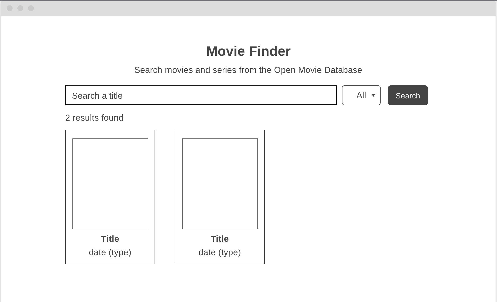
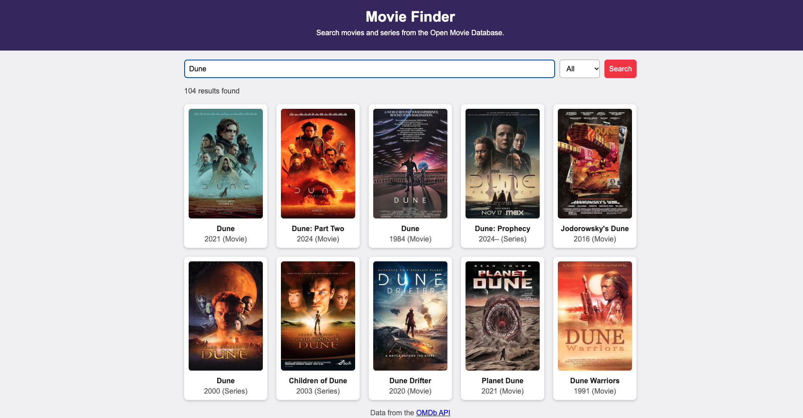

# web_dev_1_project_2
## AJAX app

**Author(s):** Sofia Ade

## Project plan

### Project idea
This is a simple movie search app using AJAX to fetch data from the Open Movie Database (OMDb). The user can enter a search item, either a movie or series title and the results are shown as cards with poster, title, year, and type.

### Planned features
- search field for titles
- pulldown to select type of search item (all, movies, series)
- AJAX call to the OMDb API on every new search
- results are shown as cards with poster, title, year, and type
- status messages for loading, no results and errors

### Wireframe


## Web links
- **Published application:**


## About the application
This application sends a request to the OMDb API with the search text and the selected type. The JSON response is saved into a variable, and the needed fields (poster, title, year, type) are used to create the cards on the page. Each new sreach send a new request, so the data always comes live from the server.


## Technologies
- HTML5 - page structure (a form and a dynamically generated task list)
- CSS - minimalistic, card-based layout
- vanilla JavaScript - DOM scripting, from validation, event handling and element creation
- PMDb REST API - live movie data (JSON)


## How to use the application
- Type a movie or series title into the search field
- Optionally choose a type from the dropdown
- Press "Search"
- The matching titles are shown as cards


## Running the application locally
1. Clone the repository to your computer
```bash
git clone https://github.com/s98ade/web_dev_1_project_2.git
```
2. Open the project folder
3. Get a free API key from `https://www.omdbapi.com/apikey.aspx` and paste it into `API_KEY`
4. Open 'index.html' in a web browser (or use a live server extension in your IDE)


## Screenshots



## Known issues / limitations
- OMDb call returns at most 10 results per search, and there is no paging
- some titles have no poster, so their card shows only text
- the free API key has a daily limit of 1000 requests per day


## Self-assessment and learning reflection
**What did I succeed in?**
- it was simplier to find a starting point
- DOM manipulation became easier


**What was challenging?**
- I still hate CSS...
- error handling could be more gracious (like invalid input handling)


**What would I improve if I had more time?**
- error handling
- pagination
- more details per card


**What did I learn about html, css, javascripting and dom scripting?**
- I learned how to use APIs to request data, how to parse JSON, and how to present the data


**my self-assessed project grade:** 09/10 (since no demo video)


## Sources
https://www.omdbapi.com/
https://dev.to/abhidevelopssuntech/how-to-make-a-movie-app-in-vanilla-javascript-2336
Course material


**Use of GenAI:**
AI has been used for the following tasks and purposes:

- creating CSS
- giving guidance and explanation when stuck in development and suggesting improvements


